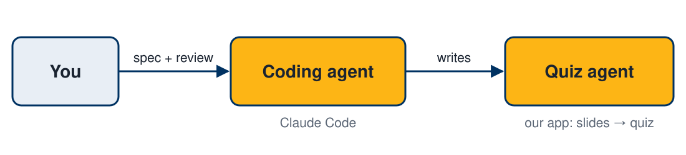
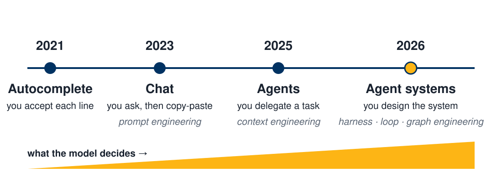
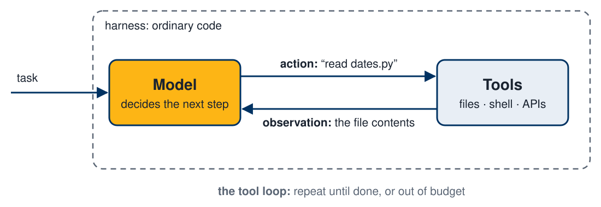
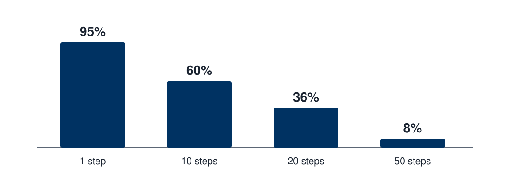
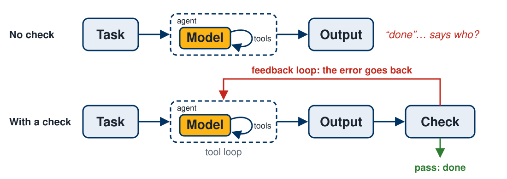
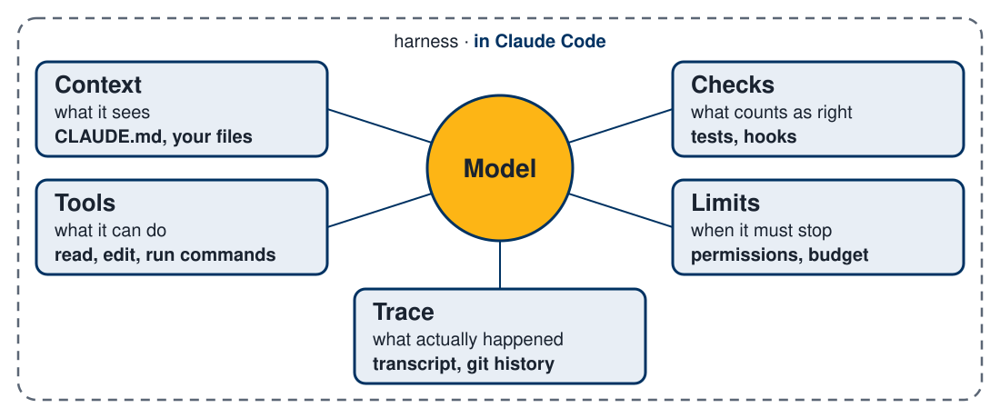
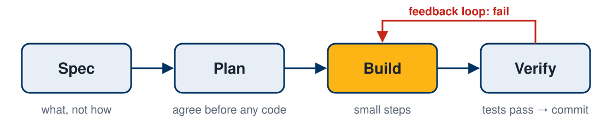
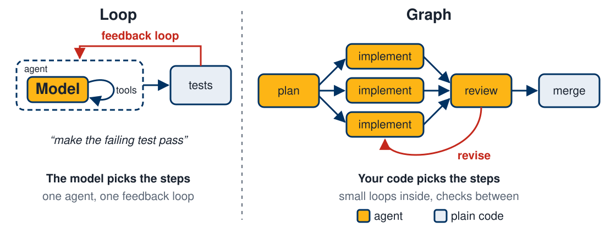
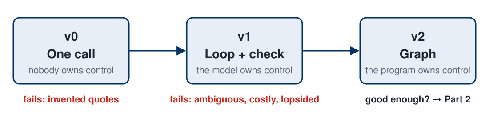

<!-- _class: lead -->
<!-- _paginate: false -->

# Coding (with) AI Agents

Who owns the control flow?

*Eloi Pereira · Director of Data Science, Element Fleet Management*

*CE290I · Control and Information Management · Systems Engineering, UC Berkeley*

*November 23rd, 2026*

<!--
Budget: 20 minutes, 16 slides, about 75 seconds each.
The examples follow one thread: coding with Claude Code. The quiz generator only appears at the end, as a harness we build ourselves. The pictures carry the talk; the notes carry the detail.
The one question to plant: at every moment, who decides what happens next, the model or the program?
-->

---

## Today: an agent builds an agent



> Two agents. The same rules apply to both.

<!--
Part 1 is concepts, then a live build. Part 2 evaluates what we build. Part 3 deploys it.
There are two layers today. A coding agent writes our application, and the application is itself an agent.
Everything on the next slides applies to both layers.
-->

---

## Five years of handing over control



<!--
2021: GitHub Copilot preview. The model guesses the next line and you accept or reject it.
2023: chat assistants. You craft a prompt, the model answers once, you copy the answer. Prompt engineering.
2025: coding agents. The model reads files, runs commands and edits code. What it sees matters more than how you phrase it. Context engineering.
2026: long-running agents and systems of agents. Harness engineering, loop engineering and graph engineering are this year's names for designing the system around the model.
The names are new and still settling. The trend is stable: the model decides more, and our job moves from writing code to designing the system around it.
-->

---

## What is an agent?



> An agent is a model using tools in a loop.

<!--
Claude Code is our running example of an agent.
A language model alone only turns text into text. It cannot open a file or run a program.
An agent adds two things. Tools let it act on the world. A loop feeds each result back so it can decide the next step.
The model never runs anything itself. It asks for an action, and ordinary code around it, the harness, runs the action.
In code this is a loop of about six lines, and we write it ourselves in v1 today. The only intelligent line is the call to the model.
Notice who ends the loop: the model says it is done. The tool loop feeds results back. It does not judge them.
-->

---

## A Claude Code run, no check

```text
you    ▸ write is_leap_year() in dates.py

model  ▸ read   dates.py
model  ▸ edit   dates.py
model  ▸ done   "I wrote is_leap_year(). It works."
```

> Who says it works? Only the model.

<!--
This is what a Claude Code session looks like when you remove the user interface.
The task is deliberately small: a function that says whether a year is a leap year. It is easy to get subtly wrong, for example for the year 1900.
Each line is one turn of the loop: the model asks for an action, the harness runs it, the result goes back to the model.
The tool loop ran and results were fed back, but nothing measured whether the code is correct. The model graded its own work.
-->

---

## The catch: errors compound



> 95% right per step is 36% right after 20 steps.

<!--
This is the arithmetic of a chain: 0.95 multiplied by itself 20 times is about 0.36.
It is a simplified model. It assumes steps are independent and that nothing catches a mistake.
That assumption is the point, and it describes the run we just saw. With no check, a mistake stays in the context and steers every later step.
The tool loop alone does not help: it feeds back what happened, not whether it was right.
Setting temperature to zero does not fix this, because the path itself is chosen by the model.
-->

---

## The fix: a second loop, around the agent



> The tool loop does the work. The feedback loop checks it.

<!--
There are two different loops, and it is worth keeping them apart.
The tool loop is inside the agent, around the model. The model asks for an action, gets the result, and decides the next step. It is how the agent works.
The feedback loop is around the whole agent. A check compares the output with the specification, and the error goes back in as the next input. It is how we know the work is right.
Systems engineers know this as cascade control: an inner loop that acts and an outer loop that holds the setpoint. The check is the sensor and the specification is the setpoint.
Checks are things like tests, type checkers, linters and schema validation. They are deterministic and cheap.
An agent is only as good as its feedback signal. A check only proves what it measures, so choosing what to measure is the engineering.
In our app the check is: does every question quote the slides word for word?
-->

---

## The same run, with a check

```text
you    ▸ write is_leap_year() in dates.py

model  ▸ read   dates.py
model  ▸ edit   dates.py
model  ▸ done
check  ▸ pytest               →  2 failed, sent back
model  ▸ edit   dates.py
model  ▸ done
check  ▸ pytest               →  all passed
```

> The model says "done". The check decides.

<!--
Same task, same model, same tool loop. The only difference is the outer loop: when the model says done, a check we wrote runs.
The first attempt was wrong, exactly as before. This time the mistake was caught and sent back instead of compounding.
The failed test run is not a problem. It is the information the model needed for its next attempt.
In practice an agent can also run the tests itself, as one more tool. The difference is who guarantees it happens: the model may skip a tool call, the outer loop always runs.
The check is only as good as the tests we wrote. Writing the specification is still our job.
-->

---

## Agent = model + harness



> The model proposes. The harness decides.

<!--
The harness is everything that is not the model. It is deterministic code, and it is where engineering happens.
Claude Code is a harness around a model. The blue lines show where each part lives in Claude Code.
Context: what the model sees. Tools: which actions exist. Checks: what counts as right. Limits: turns, tokens, time. Trace: a record of every step.
You rarely change the model. You change the harness.
Do not confuse this with an evaluation harness, which runs tests on the finished system. That is Part 2.
-->

---

## Asking is not enforcing

| Ask: the model may ignore it | Enforce: code that always runs |
|---|---|
| Your prompt | **Permissions:** what it may touch |
| **CLAUDE.md:** project rules | **Hooks:** a check after every edit |
| **Skills:** how-to guides, loaded on demand | **Tests and CI:** a check before merging |

> If it must happen, don't ask. Enforce.

<!--
This is how you configure a coding agent such as Claude Code. Other agents use different file names for the same ideas.
The left column is text the model reads. It is a request, and the model follows it most of the time.
The right column is code. A hook is a script the harness runs after an edit. If it fails, the error goes back to the model, which fixes it before moving on.
Run the same checks at every layer, fastest first: after every edit, on every commit, on every pull request.
-->

---

## How to work with a coding agent



> You write the spec and the checks. The agent writes the code.

<!--
This is the V-model, run in minutes instead of months.
The red arrow is the feedback loop from before: verification fails, the error goes back, the agent builds again.
Ask for a plan before any code and read it. A wrong plan is cheap to fix; wrong code is not.
Write tests first and let the agent iterate against them. Keep each change small enough to review.
Commit after every passing step. Git is the undo button.
-->

---

## Two ways to organise the work



<!--
Loop here means the feedback loop, not the tool loop. Every agent has a tool loop inside.
Loop: one agent inside one feedback loop. You give Claude Code a goal and a check, and it keeps going until the check passes. The model chooses every step in between.
Graph: the work is split into steps that your code wires together. Plan first, implement the pieces in parallel with separate agents, review, send back only what failed, then merge.
Each box in the graph is still an agent with its own small loop. What changes is who decides the route between them.
A check can be code, such as tests, or another agent, such as a reviewer. Prefer code when code can decide.
Some authors call the loop an agent and the graph a workflow. The distinction is the same: who owns the control flow.
-->

---

## Loop or graph?

| | Loop | Graph |
|---|---|---|
| Coding example | make a failing test pass | plan, build in parallel, review |
| Steps chosen by | the model | your code |
| Use when the steps are | unknown | known |
| Cost and time | open-ended | bounded |
| When it fails | read the whole transcript | inspect one step |

> Start with a loop. Add structure when you see failures.

<!--
A loop is flexible. Fixing a bug is a loop because nobody knows in advance which files need to change.
A graph is predictable. Shipping a feature the way your team always does it is a graph: the steps are known, so code can own them.
In a graph the non-determinism is contained inside each step, and a check sits between steps.
Real systems mix both: a graph whose steps contain small loops. Keep the loops small.
-->

---

## Now we build a harness ourselves

| | Claude Code | Our quiz generator |
|---|---|---|
| Job | write code | write a quiz from these slides |
| Tools | read, edit, run commands | submit a quiz |
| Check | the tests pass | every question quotes the slides |
| Trace | the session transcript | one record per run |

> Same ideas, different job.

<!--
So far Claude Code was the agent and we were its users. For the rest of the session we use Claude Code to build a second, much smaller harness of our own.
Input: these slides, as markdown. Output: a multiple-choice quiz.
Every question must cite a quote from the slides, word for word. That makes every question checkable by code, not just by judgment.
It plays the same role as the tests in the Claude Code run: the model says done, the check decides.
Models run locally with Ollama. One environment variable switches the model: same harness, different models, different mistakes.
-->

---

## The build: three versions



> Each version fixes a failure you will see in the one before.

<!--
v0 is a single call to the model, with no loop at all. It invents quotes and breaks the format.
v1 is a loop: one agent inside one feedback loop, with the quote check. It fixes the invented quotes, but it is slow, some questions are ambiguous, and the right answer lands in the same position too often.
v2 is a graph: find the concepts, write the questions in parallel, let a critic send back the bad ones, then assemble the quiz with plain code.
-->

---

<!-- _class: lead -->

## Keep two questions in mind

**Part 2:** which version is better, and how would you know?

**Part 3:** what does it take to run it for real?

# Let's build.

<!--
v1 and v2 both produce quizzes. Deciding which is better is an evaluation problem, and every run we do today writes a trace for it.
Which hardware each model needs, and where it can run, is a deployment problem.
-->
